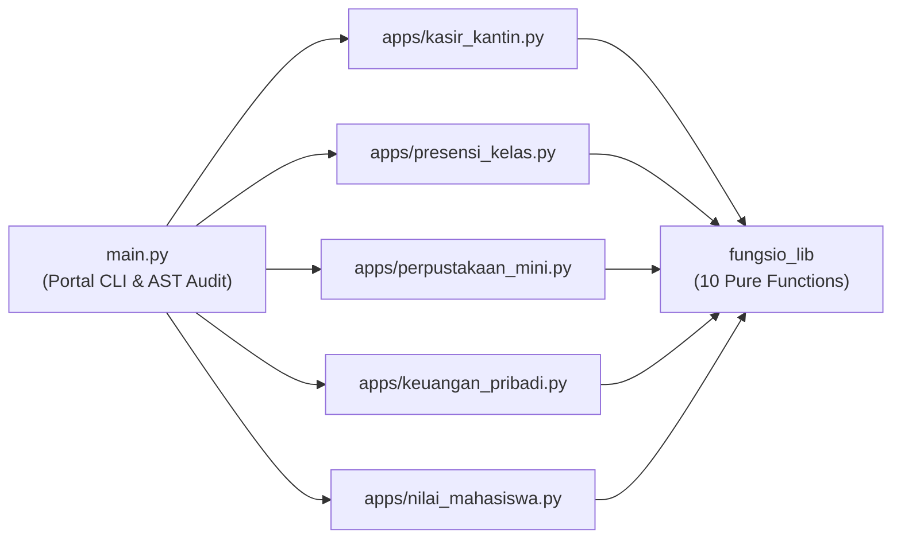

# Fungsio Library (`fungsio_lib`) & 5 Aplikasi CLI Python


Repositori ini mengimplementasikan **1 library fungsional Python (`fungsio_lib`)** berisi **10 pure functions** yang *reusable* dan **5 aplikasi CLI interaktif**. Setiap fungsi dalam library dipakai di **4 hingga 5 aplikasi berbeda** dan diaudit secara otomatis menggunakan AST (*Abstract Syntax Tree*).

---

## Daftar Isi

- [Prinsip & Arsitektur](#prinsip--arsitektur)
- [Struktur Direktori](#struktur-direktori)
- [Referensi 10 Fungsi `fungsio_lib`](#referensi-10-fungsi-fungsio_lib)
- [Matriks Pemakaian Fungsi (10 × 5)](#matriks-pemakaian-fungsi-10--5)
- [Rincian 5 Aplikasi CLI](#rincian-5-aplikasi-cli)
- [Cara Menjalankan & Pengujian](#cara-menjalankan--pengujian)

---

## Prinsip & Arsitektur

Seluruh pengolahan data dipusatkan di [`fungsio_lib/core.py`](fungsio_lib/core.py) dengan aturan:
- **Pure Functions**: Output bergantung penuh pada argumen input tanpa efek samping I/O di dalam fungsi inti.
- **Strict Immutability**: Menggunakan `copy.deepcopy` sehingga koleksi awal (termasuk *nested list/dict*) tidak pernah termutasi.
- **Higher-Order Function & Declarative Aggregation**: Memakai fungsi pemetaan (`transform_records`), komprehensi list, dan generator bawaan Python.
- **3-Layer Separation**:
  1. **Library Inti (`fungsio_lib/`)** — 10 fungsi murni pengolah `list[dict]`.
  2. **Logika Domain & Adapter CLI (`apps/`)** — aturan bisnis, data awal (*seed data*), pemformatan tabel, dan menu interaktif per aplikasi.
  3. **Portal Utama & Audit (`main.py`)** — peluncur menu interaktif 5 aplikasi, mode `--demo`, dan pemindai AST `inspect_library_usage()`.



---

## Struktur Direktori

```text
Fungsio_API/
├── fungsio_lib/
│   ├── __init__.py          # Ekspor 10 pure functions utama
│   └── core.py              # Implementasi 10 pure functions + validasi tipe
├── apps/
│   ├── __init__.py          # Helper bersama: format_idr, next_prefixed_id, validasi input, run_menu_loop
│   ├── kasir_kantin.py      # App 1: Menu, keranjang, total belanja
│   ├── presensi_kelas.py    # App 2: Kehadiran & rekap per mahasiswa
│   ├── perpustakaan_mini.py # App 3: Katalog, peminjaman, denda
│   ├── keuangan_pribadi.py  # App 4: Pemasukan, pengeluaran, kategori
│   └── nilai_mahasiswa.py   # App 5: Komponen nilai, nilai akhir, peringkat
├── tests/
│   └── test_all.py          # 14 unit test, integrasi 5 aplikasi, dan verifikasi AST 10x5
├── main.py                  # Launcher portal CLI interaktif & runner --demo
├── .gitignore
└── README.md
```

---

## Referensi 10 Fungsi `fungsio_lib`

Seluruh fungsi memvalidasi bahwa koleksi bertipe `list[dict]` dan menolak tipe `bool` pada kolom numerik (`_to_numeric`).

### A. Manipulasi Data (*Immutable CRUD & Mapping*)

| No | Fungsi | Signature | Input → Output |
| :-: | :--- | :--- | :--- |
| **1** | `add_record` | `(collection, record) -> list[dict]` | Menambah salinan `record` ke akhir salinan baru `collection`. |
| **2** | `update_by_id` | `(collection, id_field, target_id, updates) -> list[dict]` | Menggabungkan `updates` pada record dengan `id_field == target_id` secara *immutable*. |
| **3** | `remove_by_id` | `(collection, id_field, target_id) -> list[dict]` | Menghapus seluruh record yang cocok dengan `target_id` dan mengembalikan list baru. |
| **4** | `transform_records` | `(collection, transformer) -> list[dict]` | *Higher-order function* yang memetakan `transformer(record)` ke setiap item untuk menghitung atribut turunan. |

### B. Pencarian & Pengurutan

| No | Fungsi | Signature | Input → Output |
| :-: | :--- | :--- | :--- |
| **5** | `filter_by_field` | `(collection, field, value) -> list[dict]` | Menyaring record yang memiliki `field` bernilai sama persis dengan `value`. |
| **6** | `search_by_keyword` | `(collection, field, keyword) -> list[dict]` | Mencari substring *case-insensitive* pada `field` (string kosong mengembalikan salinan seluruh data). |
| **7** | `sort_records` | `(collection, sort_field, descending=True) -> list[dict]` | Mengurutkan data berdasarkan `sort_field` lalu menyematkan key `rank` (`1..N`). |

### C. Agregasi & Pengelompokan

| No | Fungsi | Signature | Input → Output |
| :-: | :--- | :--- | :--- |
| **8** | `sum_by_field` | `(collection, numeric_field) -> float` | Menjumlahkan nilai angka pada `numeric_field` (nilai `None`/hilang dianggap `0.0`). |
| **9** | `group_by_field` | `(collection, key_field) -> dict[Any, list[dict]]` | Mengelompokkan record ke dalam dictionary berdasarkan nilai `key_field`. |
| **10** | `calculate_summary_stats` | `(collection, numeric_field) -> dict[str, float]` | Menghitung `count`, `total`, `average`, `min`, dan `max` (mengembalikan `0.0` saat koleksi kosong). |

### Contoh Pemakaian Singkat

```python
from fungsio_lib import add_record, transform_records, sort_records, sum_by_field

cart = add_record([], {"id_menu": "M01", "nama": "Nasi Goreng", "harga": 18000, "qty": 2})
cart_subtotal = transform_records(cart, lambda x: {**x, "subtotal": x["harga"] * x["qty"]})
ranked = sort_records(cart_subtotal, "subtotal", descending=True)
total = sum_by_field(ranked, "subtotal")  # 36000.0
```

---

## Matriks Pemakaian Fungsi (10 × 5)

Diaudit langsung lewat AST (`tests/test_all.py` & `main.py --demo`). Seluruh 10 fungsi melampaui syarat minimal 3 aplikasi (**6 fungsi dipakai di 5 aplikasi**, **4 fungsi dipakai di 4 aplikasi**):

| No | Fungsi Library | 1. Kasir Kantin | 2. Presensi Kelas | 3. Perpustakaan Mini | 4. Keuangan Pribadi | 5. Nilai Mahasiswa | Total |
| :-: | :--- | :---: | :---: | :---: | :---: | :---: | :---: |
| 1 | `add_record` | ✅ | ✅ | ✅ | ✅ | ✅ | **5 App** |
| 2 | `filter_by_field` | ✅ | ✅ | ✅ | ✅ | ✅ | **5 App** |
| 3 | `search_by_keyword` | ✅ | ✅ | ✅ | ✅ | ✅ | **5 App** |
| 4 | `update_by_id` | ✅ | ✅ | ✅ | ✅ | ✅ | **5 App** |
| 5 | `remove_by_id` | ✅ | ✅ | ✅ | ✅ | ✅ | **5 App** |
| 6 | `transform_records` | ✅ | ✅ | ✅ | ✅ | ✅ | **5 App** |
| 7 | `sum_by_field` | ✅ | ✅ | ✅ | ✅ | — | **4 App** |
| 8 | `group_by_field` | — | ✅ | ✅ | ✅ | ✅ | **4 App** |
| 9 | `sort_records` | ✅ | ✅ | — | ✅ | ✅ | **4 App** |
| 10 | `calculate_summary_stats` | ✅ | — | ✅ | ✅ | ✅ | **4 App** |

---

## Rincian 5 Aplikasi CLI

### 1. Kasir Kantin ([`apps/kasir_kantin.py`](apps/kasir_kantin.py))
- **Fokus**: Manajemen menu kantin, keranjang belanja, dan kalkulasi total bayar.
- **Aturan Bisnis**: Diskon otomatis **10%** jika total kotor `>= Rp50.000` dan **PPN 11%** setelah diskon.
- **Alur Data**: `transform_records` (`subtotal = harga * qty`) → `sort_records` (urut subtotal) → `sum_by_field` (total item & kotor).
- **Menu Interaktif**:
  1. Lihat semua menu urut harga termurah & statistik harga
  2. Filter kategori (`Makanan`/`Minuman`) atau cari nama menu
  3. Tambah item ke keranjang (otomatis menambah `qty` jika sudah ada + tampilkan struk terbaru)
  4. Ubah / tambah jumlah item di keranjang (pilih berdasarkan `ID Menu`, nomor baris struk, atau nama; mendukung mode `+qty` atau `set qty`)
  5. Hapus item dari keranjang (`ID Menu`, nomor baris, atau nama)
  6. Lihat keranjang & total belanja
  7. Tambah menu kantin baru (`M07`, dst.)

### 2. Presensi Kelas ([`apps/presensi_kelas.py`](apps/presensi_kelas.py))
- **Fokus**: Pencatatan log kehadiran per pertemuan dan rekap persentase per mahasiswa.
- **Aturan Bisnis**: Bobot poin `Hadir = 1.0`, `Izin = 0.5`, `Sakit = 0.5`, `Alfa = 0.0`. Mahasiswa dinyatakan **Layak UAS** bila persentase kehadiran `>= 75%`. Mencatat `(NIM, pertemuan)` yang sama otomatis memperbarui status log tanpa duplikasi.
- **Alur Data**: `transform_records` (bobot poin) → `group_by_field` (per `nim`) → `sum_by_field` (total poin) → `transform_records` (`% Hadir` & status UAS) → `sort_records` (peringkat kehadiran).
- **Menu Interaktif**: Lihat log, catat kehadiran (deteksi nama otomatis bila NIM ada), koreksi status log, hapus log, filter status, lihat rekap per mahasiswa, dan cari rekap mahasiswa.

### 3. Perpustakaan Mini ([`apps/perpustakaan_mini.py`](apps/perpustakaan_mini.py))
- **Fokus**: Pengelolaan katalog buku, transaksi peminjaman/pengembalian, dan denda keterlambatan.
- **Aturan Bisnis**: Batas pinjam bebas denda **7 hari**, denda keterlambatan **Rp2.000/hari**. Pengembalian atau penghapusan log pinjaman yang masih berstatus `Dipinjam` otomatis memulihkan status buku menjadi `Tersedia`.
- **Alur Data**: `transform_records` (`hari_terlambat` & `denda`) → `sum_by_field` (total denda) → `calculate_summary_stats` (rata-rata & denda tertinggi).
- **Menu Interaktif**: Lihat katalog & kategori, filter buku tersedia / cari judul, pinjam buku, kembalikan buku, hapus log pinjaman, lihat laporan denda, dan tambah buku baru.

### 4. Keuangan Pribadi ([`apps/keuangan_pribadi.py`](apps/keuangan_pribadi.py))
- **Fokus**: Pencatatan `Pemasukan` dan `Pengeluaran`, rekap saldo bersih, dan rincian per kategori.
- **Aturan Bisnis**: Setiap transaksi dipetakan menjadi `arus_kas` bertanda (`+nominal` untuk `Pemasukan`, `-nominal` untuk `Pengeluaran`) agar saldo bersih dapat langsung direduksi.
- **Alur Data**: `transform_records` (`arus_kas`) → `filter_by_field` (pisah masuk/keluar) → `sum_by_field` (total & saldo) → `group_by_field` (per `kategori`) → `sort_records` (3 pengeluaran terbesar) & `calculate_summary_stats`.
- **Menu Interaktif**: Lihat semua transaksi + ringkasan saldo, tambah transaksi, edit transaksi, filter tipe/kategori atau cari keterangan, hapus transaksi, dan lihat laporan lengkap kategori & statistik.

### 5. Nilai Mahasiswa ([`apps/nilai_mahasiswa.py`](apps/nilai_mahasiswa.py))
- **Fokus**: Pengolahan 4 komponen nilai, perhitungan nilai akhir berbobot, huruf mutu, dan pemeringkatan kelas.
- **Aturan Bisnis**: Bobot **Tugas 25%**, **Kuis 15%**, **UTS 30%**, **UAS 30%**. Konversi huruf mutu: `A (>= 85)`, `B (>= 75)`, `C (>= 60)`, `D (>= 50)`, `E (< 50)`. Status `Lulus` untuk `nilai_akhir >= 60`.
- **Alur Data**: `transform_records` (`nilai_akhir`, `grade`, `status_lulus`) → `sort_records` (peringkat `1..N`) → `filter_by_field`, `group_by_field` (sebaran grade), & `calculate_summary_stats`.
- **Menu Interaktif**: Lihat peringkat & statistik kelas, input mahasiswa baru, revisi 1 atau seluruh komponen nilai, hapus data mahasiswa, filter kelulusan / cari nama, dan lihat distribusi huruf mutu.

---

## Cara Menjalankan & Pengujian

### Persyaratan
- **Python 3.10+** (tanpa instalasi library pihak ketiga).

### 1. Menjalankan Portal Menu Interaktif
```bash
python main.py
```

### 2. Menjalankan Mode Demo Otomatis + Audit Matriks AST
Menjalankan simulasi seluruh 5 aplikasi secara berurutan dan mencetak tabel verifikasi AST 10×5:
```bash
python main.py --demo
```

### 3. Menjalankan Seluruh Unit & Integration Tests
Menjalankan 14 skenario pengujian (immutability ke-10 fungsi, integrasi 5 aplikasi, perbaikan edge-case CRUD, serta audit AST minimal 3 aplikasi per fungsi):
```bash
python -m unittest discover -s tests -v
```
